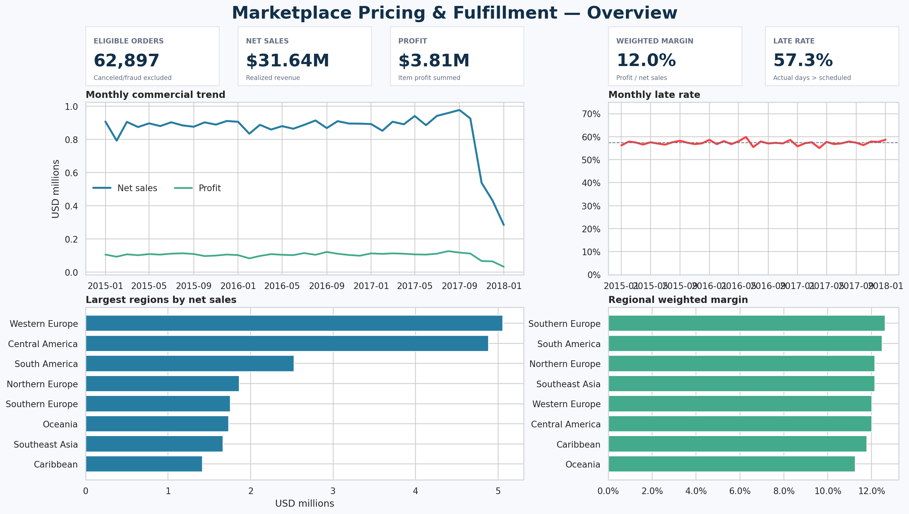
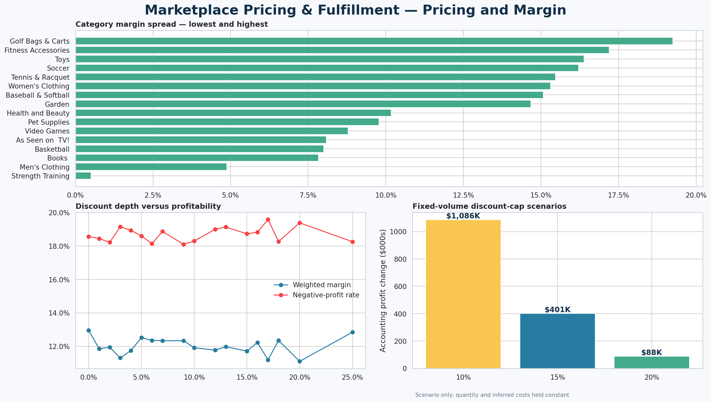
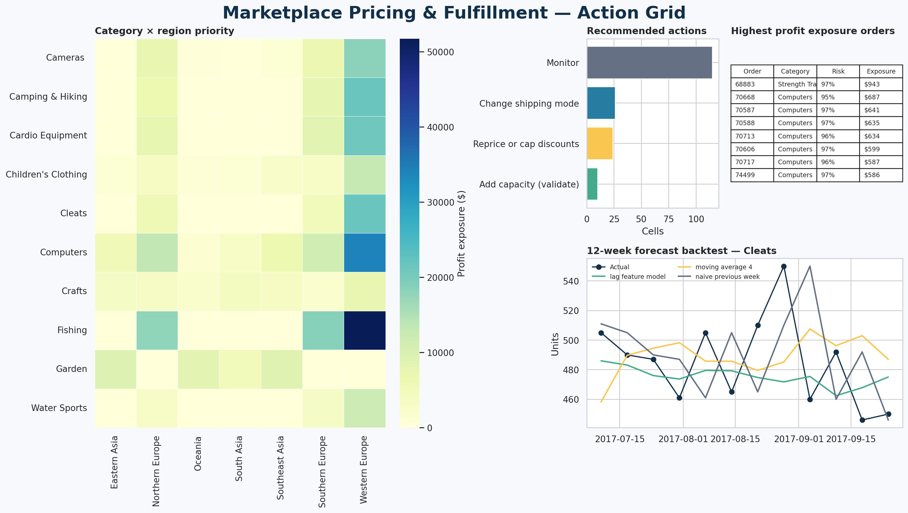

# Marketplace Pricing & Fulfillment Analytics

An end-to-end SQL, Python, scikit-learn, and Power BI portfolio project using the DataCo Smart Supply Chain dataset.

> Project status: reproducible analytics pipeline complete; Power BI Desktop assembly and screenshots remain to be completed.

## Business questions

1. Where are discounts associated with weak or negative margins?
2. Which orders have the greatest late-delivery risk using information available at order time?
3. What is the short-horizon demand outlook for consistently active, high-volume categories?
4. Which category-region cells deserve attention based on delivery risk and profit exposure?

## Data source

- DataCo SMART SUPPLY CHAIN FOR BIG DATA ANALYSIS
- Authors: Fabian Constante, Fernando Silva, and António Pereira
- DOI: <https://doi.org/10.17632/8gx2fvg2k6.5>
- Kaggle distribution: <https://www.kaggle.com/datasets/shashwatwork/dataco-smart-supply-chain-for-big-data-analysis>
- License: CC BY 4.0 on the authoritative Mendeley record

The source CSV is intentionally excluded from Git. See `data/README.md`.

## Repository structure

```text
data/          Raw, processed, and exported data (generated files ignored)
docs/          Data dictionary, methodology, model evaluation, and manager memo
models/        Generated model artifacts (ignored)
notebooks/     Exploration notebooks that call reusable source modules
outputs/       Generated figures and tables (ignored)
powerbi/       Power BI file and dashboard screenshots
sql/           SQLite schema, transformation, and QA SQL
src/           Reproducible Python pipeline
tests/         Automated data-contract and pipeline tests
```

## Quick start

```powershell
python -m venv .venv
.\.venv\Scripts\Activate.ps1
python -m pip install -r requirements.txt
python -m src.download_data
python -m src.run_pipeline
```

The pipeline expects `data/raw/DataCoSupplyChainDataset.csv`, read with `encoding="latin-1"`.

Running the pipeline performs these steps in order:

1. Profiles and validates the 180,519-row source file.
2. Creates the SQLite staging, item, and order layers.
3. Executes structural and business QA checks.
4. Produces pricing, margin, discount, and indicative price-sensitivity outputs.
5. Trains time-split late-delivery models with and without shipping-promise fields.
6. Backtests weekly category-demand forecasts against two baselines.
7. Generates the priority grid and privacy-safe Power BI input tables.

## Reproduced results

- Eligible net sales: **$31.64 million**
- Profit: **$3.81 million**
- Weighted margin: **12.03%**
- Negative-profit item rate: **18.69%**
- Chronological test late rate: **57.45%**
- Best enriched operational model ROC-AUC: **0.773**
- Shipping-mode-only rule ROC-AUC: **0.744**
- Best enriched model without shipping mode and scheduled days: **0.522**
- Best category forecast WAPE ranges from **5.06% to 8.79%**

Detailed results are in:

- `docs/pricing_analysis.md`
- `docs/model_evaluation.md`
- `docs/delivery_diagnostics.md`
- `docs/forecast_evaluation.md`
- `docs/manager_memo.md`
- `docs/priority_score.md`

## Dashboard

The three-page Power BI design is specified in `docs/dashboard_spec.md`. Generated inputs are written to `data/exports/`, and starter measures are in `powerbi/measures.dax`.

Dashboard previews generated from the Power BI input tables:







These are reproducible visual specifications. The native `.pbix` remains pending because Windows application automation was unavailable during this build session.

## Analysis policy

- The source grain is one row per order item.
- Canceled and suspected-fraud orders remain in staging but are excluded from realized commercial KPIs, delivery modeling, and demand forecasting.
- Late delivery is calculated as actual shipping days greater than scheduled shipping days for eligible orders.
- Customer names, email, password, street, ZIP code, and precise coordinates are excluded from analytical exports.
- Pricing and discount findings are observational. Simulations are scenarios, not causal estimates.

## Limitations

- The order history ends in January 2018 and may not represent current fulfillment behavior.
- The source may be synthetic or simulated; conclusions require validation on operational data.
- Competitor prices, reviews, inventory, capacity, and the measured cost of lateness are unavailable.
- Shipping mode and scheduled days are perfectly redundant, and they dominate late-risk performance because scheduled days are part of the target definition.
- Category availability changes abruptly, so forecasts are evaluated on each category's active history rather than interpreting missing assortment coverage as zero demand.

## How a junior analyst could extend this

A junior analyst could own the weekly data refresh, investigate failed QA checks, monitor model calibration and forecast WAPE, and add inventory or carrier-cost data when available. Useful extensions include rolling-origin validation, confidence intervals for elasticity estimates, controlled discount experiments, and drift monitoring for shipping-mode performance.

